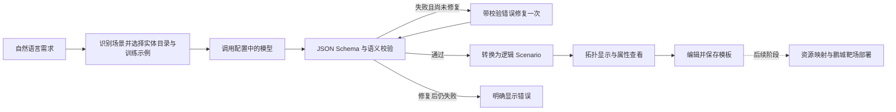

# 第二阶段：提示词到逻辑拓扑

调研日期：2026-10-29。第一阶段基线提交：`597ee431554db9497f2e1fcc0c729928b014debe`。

## 已确认范围

先完成通信网络及服务、新型数据中心网络及服务、新型城域网及服务三类场景的逻辑拓扑生成、编辑和保存。真实鹏城靶场部署另行对接。

用户输入文字后，系统需要完整保留设备/网元、数量、属性，以及连接、控制、注册、承载、管理等关系。逻辑关系不等于物理网线。没有提供的 IP、镜像、规格不应自动补造。

## 已检查的材料

- 第一阶段仓库已克隆到工作区 `CRaaS/`，实际上包含 React/Vite 前端、FastAPI 后端和 SQLite 模板存储。
- 经授权读取的参考工程源码、提示词、实体目录和数据集已下载至本地工作区 `reference/bachang-service/`；运行时不依赖参考服务器。
- 参考工程主要由数据生成与评测脚本、OCI 容器镜像及镜像补丁组成，不是可以直接合并的同构后端。已从容器层读取模型客户端与服务器源码，未启动或修改远端容器。
- 参考工程的实际调用路由是 `/topo-api/api/generate-json`，返回 SSE 包装的 `nodes/links/edges/groups/topology_data`。现有前端调用 `/api/topology/generate`，接受 `scenario/validation/generator`，且节点类型、分组、属性结构均不同。
- 三类分别有 70、36、50 种实体类型，共 156 种。各有 200 条训练和 100 条测试数据，总计 600 条训练、300 条测试。已验证数量及清单 SHA256；没有发现训练/测试全文完全重复，但数据由类似模板生成，不能据此推断真实自由输入的泛化能力。
- 测试文本约 2200–4500 字，包含 30–50 类实体、30–61 条关系，明显超出现有提示词的 8–16 个节点限制。

## 已复现的问题

| 位置 | 问题 | 处理方式 |
| --- | --- | --- |
| 原规则生成器 | 输入 12 台办公电脑只生成 6 台；即使描述不联网仍添加互联网与防火墙 | AI 路径独立抽取事实，规则不作为失败后的替代结果 |
| 原 `normalize()` | 丢失实体编码、数量、属性、证据，以及关系类型、接口、协议；默认补镜像和网段 | 引入结构化抽取及独立的逻辑拓扑转换器 |
| 原拓扑校验 | 可能放过不存在的关系端点；默认把无连接视为错误 | 逻辑拓扑检查引用和数量；未描述连接只告警，不补线 |
| 参考示例构建 | 数据中心/城域网金标用 `link_or_protocol`，脚本只读 `interface_or_link`，两类示例全部丢失链路标签 | 修复字段映射，运行时使用修正后的训练示例 |
| 参考示例内容 | 输出含输入中没有写出的属性 | 在修正后的示例输入中明确写出示例输出的所有属性 |
| 参考拓扑转换 | 按端点和标签去重，可能吞掉不同类型但相同标签的关系 | 每条经过语义校验的关系对应一条边 |
| 参考跨场景处理 | Schema 支持 secondary_scenes，但实体校验只允许主场景目录 | 使用主场景及明确的次场景目录的并集 |
| 原前端编辑器 | 不提供关系的表单编辑 | 新增关系端点、类型、接口和协议编辑，支持增删 |
| 原计算驱动 | OpenStack 驱动主要按节点创建 VM，并未按 links 构造网络 | 不把它当作已完成鹏城靶场对接的证据 |

## 接入方案与当前实现

继续使用第一阶段的前端、API 路径风格及模板存储。无需引入第二套 Node 服务，也不需要先训练/微调模型。

1. 运行时资产：将实体目录、JSON Schema、系统提示词、修正后的 6 条训练示例放在 `backend/app/assets/topology/`。不打包测试输入和测试答案。
2. 模型配置：根目录 `llm.local.json` 保存多组 profile，`active_profile` 决定当前使用项；实际文件被 Git 忽略。支持 OpenAI 和 Anthropic 两种协议，每次生成读取配置。环境变量可覆盖本地配置。
3. 模型调用：后端读取密钥，流式接收文本，页面不接触密钥。当前接口的 `glm-5.3-flash` 在 `/v1/messages` 可用，在 `/v1/chat/completions` 返回 503。长请求不使用非流式模式，以免约 125 秒后发生网关 524。
4. 抽取：实体保留稳定 ID、标准实体类型、数量、属性、原文依据和置信度；关系保留方向、类型、接口、协议及证据。置信度为模型自报，不等同于经过校准的概率。
5. 校验：先检查 JSON Schema，再检查 ID 唯一、目录成员、关系端点、自连接和重复关系。失败最多修复一次，不自动生成固定模板替代。
6. 转换：保留兼容的 `zones/nodes/links`，补充 `kind=logical`、语义字段及模型信息。分组表示逻辑类别，不自动赋予物理子网。数量为逻辑节点数量属性，不展开成任意数量的 VM。
7. 网页：生成按钮创建后台任务，轮询状态，显示模型、接收字符数和耗时。图中显示数量、接口标签和有向关系；可查看属性及关联关系原文，保存后支持节点和关系编辑。
8. 保存：沿用模板表的 JSON 字段。编辑后的 nodes/links 是当前版本，不保留一份可能与编辑结果冲突的可写 extraction 副本。
9. 部署边界：逻辑拓扑没有镜像、规格、网络映射时，界面禁用部署，后端也拒绝实例预览/部署，避免把逻辑图误当作运行环境。

### 新增接口

- `POST /api/topology/jobs`：提交 `{description, scene?, industry?, business?, name?}`，返回 202 和任务 ID。`scene` 默认 `auto`。
- `GET /api/topology/jobs/{id}`：返回 `queued/running/succeeded/failed`、阶段、已接收字符数、模型以及结果或错误。
- `GET /api/meta`：增加三类场景及当前模型状态，不返回密钥。
- 原 `POST /api/topology/generate`：保留同步接入能力，调用相同的 AI 抽取与转换；网页使用任务接口规避浏览器长请求。

当前后台任务在单个进程内保存，最多保留 100 项，完成一小时后清理，并发上限 3。服务重启会使未完成任务失效，页面会提示重新生成。这适用于当前本地 demo；正式多实例服务应换成持久任务表及工作队列。

## 评测及验收

必须将“实体识别”和“链路正确”分别报告。

- 参考工程的单样本标准：去重实体类型召回率 **严格大于 90%**。
- 最终验收要求：**每个样本**都须合法抽取且实体类型召回率严格大于90%；30种实体至少识别28种。三类各100条，逐条验收，不能用总体平均值或部分样本通过替代。
- 同时报告实体精确率/F1、数量正确率，以及关系端点+类型的方向敏感精确率/召回率。不能用输出全部目录实体来获得表面的高召回率。
- 接口失败、超时、截断、JSON 不合法、修复失败都计为端到端失败，同时单独统计，避免把可用性问题混同于模型识别能力。
- 测试金标仅由评分器读取，不进入提示词、运行时规则或检索。提示词和运行时脚本在全量测试前固定；如后续调整，应另标版本重测，不能声称反复调参使用的测试集仍是未见数据。

已完成的探索性训练冒烟结果（不是测试集成绩）：6/6 满足实体标准，实体平均召回率 100%，平均精确率约 99.12%，数量正确率 100%，关系平均召回率约 95.08%。平均耗时约 111 秒，最长约 177 秒。

通信网络两条训练样本的关系召回率约 82% 和 88.46%。其中金标将 NRF 注册关系记为“注册中心 → 网元”，而文本写作“网元注册到中心”；模型通常按文本方向生成。还存在 hosts/contains、connects_to/routes_for 等标签口径差异。必须保留原始评分，并另外报告争议规则，不能悄悄翻转模型输出或修改答案来抬高成绩。

此外，部分合成金标属性在对应文本中未明确出现，属性验收需要按可由原文支持的字段设计，不应要求模型猜出未写明的厂商型号、协议等。

正式测试使用用户指定的 DeepSeek 配置，复用网页后端核心代码，包含异常隔离、网络重试、进度保存与版本校验。全量运行及定向补测后的合并结果为300/300逐条达标；实体召回率99.94%、实体精确率98.42%、关系召回率97.18%、数量准确率99.75%。本地评测材料保存在仓库外的research目录，未打包进应用或提交原始预测。验证范围及参考规则对照见[最终核查报告](reference-alignment-review.md)。

## 已验证与后续顺序

已完成：前后端接入、真实模型短需求验证、动态 profile 配置、逻辑图转换、关系编辑、模板存储兼容、部署边界、后端关键用例与前端构建。

真实 API 验证中，两段不同需求分别生成 AMF/SMF/UPF 与核心/汇聚/接入 PTN，数量、关系和接口随描述变化；通过前端代理访问 API，生成约 14–16 秒；模板保存/读回完整一致。此项是实际 HTTP 集成验证，不冒充浏览器自动化或完整视觉验收。

后续按顺序进行：

1. 已完成三类共300条测试；后续保留指标与原始评分，重点审阅通信场景关系方向及标签差异。
2. 用训练集继续定位实体歧义、关系方向与标签口径；形成可审阅的领域规则，避免用测试答案定制规则。
3. 加入人工编写的自由描述、跨场景、否定要求、信息缺失、多地点同类型设备等补充验证，补足合成数据的局限。
4. 做真实浏览器验收，重点检查 30–50 节点、多关系重叠、保存后编辑、失败重试、切换模型配置与服务重启。
5. 获取鹏城靶场接口文档、场景样例和测试权限后，单独实现资源映射与部署适配器。真实物理端口、多网卡、网络隔离和镜像可用性不能从逻辑关系直接推定。

## 本地使用

本地开发网页：`http://127.0.0.1:5173/topology`。模型名称随本地active_profile显示。

配置及切换方法见[模型配置说明](model-config.md)。参考服务器未部署新服务；本实现可独立启动，不依赖老师的Docker或底层服务。
